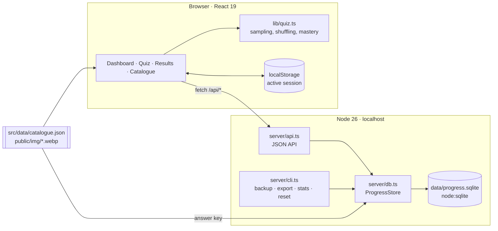
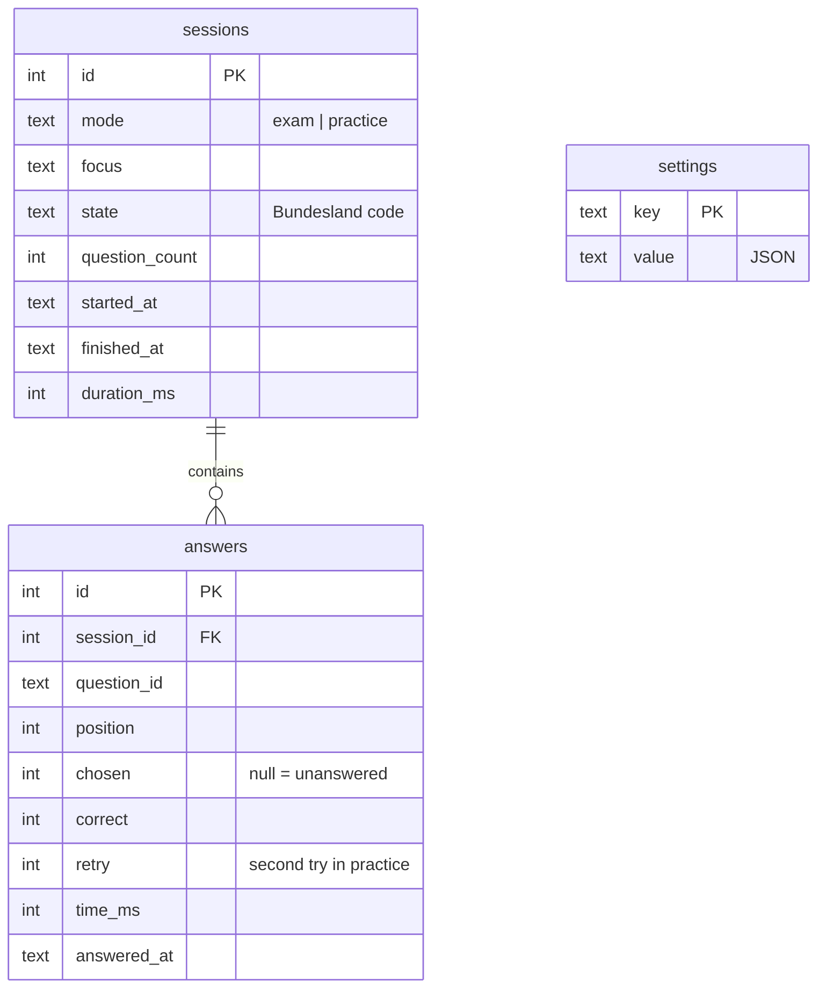
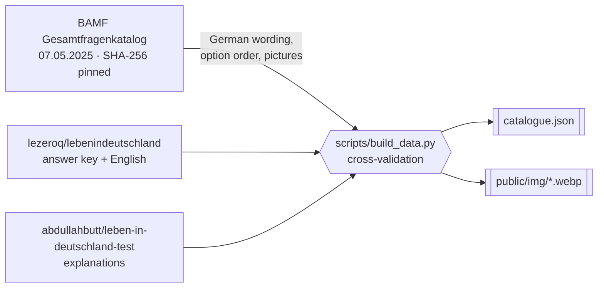

# Leben in Deutschland — Einbürgerungstest trainer

A local, bilingual (German | English) practice app for the German citizenship test,
with a SQLite database that tracks how your scores change day by day.

## Quick start

| Step | Command              | Result                                                          |
| ---- | -------------------- | --------------------------------------------------------------- |
| 1    | `make install`       | Installs JavaScript dependencies                                |
| 2    | `make start`         | Builds, serves on <http://localhost:5179> and opens the browser |
| 3    | Pick your Bundesland | Enables the 3 state questions of the real test                  |

Run `make` to list every chore.

## Features

| Mode                               | What happens                                                                  | Feedback                        |
| ---------------------------------- | ----------------------------------------------------------------------------- | ------------------------------- |
| **Prüfungssimulation** (mock exam) | 30 random general + 3 Bundesland questions, 60-minute timer, flag and revisit | After submitting; 17/33 to pass |
| **Üben** (practice)                | Smart mix, unseen, mistakes, Bundesland or whole catalogue; 10–50 questions   | After every answer              |
| **Fragenkatalog**                  | Searchable read-through of all 310 questions that can come up for you         | Answer + explanation on demand  |
| **Übersicht** (dashboard)          | Score chart, coverage, weak spots, streak, session history, settings          | —                               |

Feedback on a wrong answer shows:

- the correct option in German **and** English;
- your answer, struck through;
- an explanation of _why_ the answer is right;
- your history on that question;
- a note that it will come back four questions later, with reshuffled options.

## Questionnaire practice

| Practice              | How it is applied                                                                  |
| --------------------- | ---------------------------------------------------------------------------------- |
| No order effects      | Questions drawn and ordered at random every session                                |
| No position memory    | Answer options shuffled; picture and number options keep their meaningful order    |
| No accidental answers | Practice answers need an explicit _Prüfen_ (check); nothing is preselected         |
| Exam realism          | Answers editable until submit; confirmation lists unanswered and flagged questions |
| Spaced repetition     | Up to half of a smart-mix session revisits missed or shaky questions               |
| Mastery               | Two correct answers in a row; mastered questions resurface slowly                  |
| Robustness            | Sessions survive reloads; the exam timer runs on a wall-clock deadline             |

### Keyboard

| Key                | Action                               |
| ------------------ | ------------------------------------ |
| `1`–`4` or `A`–`D` | Choose an option                     |
| `Enter`            | Check / next                         |
| `←` `→`            | Previous / next question (mock exam) |
| `F`                | Flag question (mock exam)            |
| `E`                | Show / hide the English column       |

## Architecture

| Layer | Files                                   | Role                                                                |
| ----- | --------------------------------------- | ------------------------------------------------------------------- |
| UI    | `src/components/*`                      | Bilingual question rows, feedback, chart, dashboard                 |
| Logic | `src/lib/quiz.ts`, `src/lib/session.ts` | Exam draw, weighted practice selection, retry queue, timing         |
| API   | `server/api.ts`                         | One handler mounted in `vp dev`, `vp preview` and `server/serve.ts` |
| Store | `server/db.ts`                          | Schema migrations, scoring against the official key, statistics     |
| Data  | `scripts/build_data.py`                 | Builds the catalogue and pictures from pinned sources               |

### API

| Method   | Path                        | Purpose                                                 |
| -------- | --------------------------- | ------------------------------------------------------- |
| `GET`    | `/api/summary`              | Settings, finished sessions, per-question statistics    |
| `PUT`    | `/api/settings`             | Bundesland, exam date, English column, option shuffling |
| `POST`   | `/api/sessions`             | Start a session                                         |
| `POST`   | `/api/sessions/:id/answers` | Record a practice answer (judged server-side)           |
| `POST`   | `/api/sessions/:id/finish`  | Close a session; mock exams submit all answers here     |
| `DELETE` | `/api/sessions/:id`         | Abandon an unfinished session                           |
| `GET`    | `/api/export`               | Full JSON dump                                          |

### Database

- Stored in `data/progress.sqlite` (git-ignored); override with `LID_DB=/path/file.sqlite`.
- Retries count towards question statistics but not towards the session score.

## Question data

| Source                                                                                                                                      | Licence              | Used for                                              |
| ------------------------------------------------------------------------------------------------------------------------------------------- | -------------------- | ----------------------------------------------------- |
| [BAMF Gesamtfragenkatalog](https://www.bamf.de/SharedDocs/Anlagen/DE/Integration/Einbuergerung/gesamtfragenkatalog-lebenindeutschland.html) | Official publication | German text, option order, pictures                   |
| [lezeroq/lebenindeutschland](https://github.com/lezeroq/lebenindeutschland)                                                                 | MIT                  | Answer key (from the BAMF Online-Testcenter), English |
| [abdullahbutt/leben-in-deutschland-test](https://github.com/abdullahbutt/leben-in-deutschland-test)                                         | MIT                  | Explanations                                          |

The build stops when:

- the PDF checksum changes (a new BAMF edition — `make data-refresh` detects it);
- answer-key wording differs from the PDF;
- an explanation was written for a different correct answer;
- picture detection disagrees with the answer key.

> [!NOTE]
> Some pictures are photos credited to third parties in the BAMF PDF. They are here
> for personal study, which is why this repository is private.

## Make targets

| Group       | Targets                                                                            |
| ----------- | ---------------------------------------------------------------------------------- |
| Everyday    | `start`, `serve`, `open`, `dev`, `stats`                                           |
| Quality     | `check`, `fix`, `fmt`, `lint`, `typecheck`, `check-py`, `test`, `test-watch`, `ci` |
| Build       | `install`, `build`, `data`, `data-refresh`                                         |
| Progress    | `backup`, `export`, `reset-progress CONFIRM=yes`                                   |
| Maintenance | `outdated`, `update`, `doctor`, `clean`, `distclean`                               |

## Stack

| Concern       | Tool                                                                                                                        |
| ------------- | --------------------------------------------------------------------------------------------------------------------------- |
| Runtime       | Node 26 (native TypeScript, `node:sqlite`)                                                                                  |
| Toolchain     | [Vite+](https://viteplus.dev): Vite 8 / Rolldown, Oxlint, Oxfmt, Vitest                                                     |
| Language      | TypeScript 7 (tsgo)                                                                                                         |
| UI            | React 19, Tailwind CSS 4                                                                                                    |
| Data pipeline | Python 3.15 uv script, Ruff, ty, poppler-utils                                                                              |
| Git hooks     | [prek](https://github.com/j178/prek) with Conventional Commits                                                              |
| Design        | [indrapatil.com DESIGN.md](https://github.com/IndrajeetPatil/indrajeetpatil.github.io/blob/main/DESIGN.md), light mode only |
