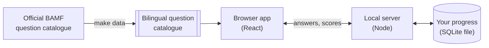
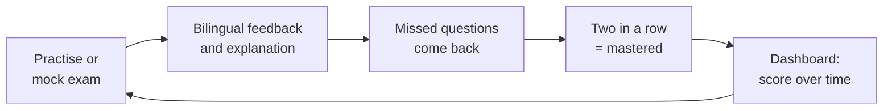

# Leben in Deutschland — Einbürgerungstest trainer

A personal study app for the German citizenship test (_Einbürgerungstest_ /
_Leben in Deutschland_). Every question is shown in German and English side by
side, so the exam language and your own build a direct correspondence. Your
results are saved locally, so you can watch your score climb towards exam day.

## What you can do

- **Take a mock exam** — the real format: 33 questions (30 general, 3 about
  your Bundesland), 60 minutes, 17 correct to pass.
- **Practise with explanations** — immediate feedback in both languages, an
  explanation of _why_ the answer is right, and missed questions coming back a
  few questions later.
- **Track your progress** — score chart up to exam day, catalogue coverage,
  weak spots and a daily streak.
- **Look things up** — a searchable read-through of all 310 questions that can
  come up for you.

## Quick start

```sh
make install   # once: locked JavaScript and Python dependencies
make start     # builds, serves on http://localhost:5179 and opens the browser
```

Pick your Bundesland and set your exam date on first launch. Run `make` to see
every other command; [CONTRIBUTING.md](CONTRIBUTING.md) covers using it for
your own exam.

## How it works



The questions are built once from the official catalogue, then everything runs
on your machine: the browser app asks the questions, and a small local server
checks each answer against the official key and stores it.



## Tech stack

| Layer      | Tools                                                                   |
| ---------- | ----------------------------------------------------------------------- |
| App        | React 19, Tailwind CSS 4, TypeScript 7                                  |
| Server     | Node 26 with its built-in SQLite (`node:sqlite`)                        |
| Toolchain  | [Vite+](https://viteplus.dev): Vite 8 / Rolldown, Oxlint, Oxfmt, Vitest |
| Data build | Python 3.15 (uv, Ruff, ty, pyrefly, pytest), poppler                    |
| Testing    | Vitest, Playwright with axe accessibility audits                        |

Most of the tooling is written in Rust (Rolldown, Oxc, Tailwind's engine, uv,
Ruff, ty, prek, typos, lychee) for fast feedback. Every lint rule is on, with
narrow exceptions explained in place; the [quality gates](docs/development.md#quality-gates)
run on every pull request.

## Documentation

| Read                                           | For                                                      |
| ---------------------------------------------- | -------------------------------------------------------- |
| [Quiz design](docs/quiz-design.md)             | Exam rules, questionnaire practices, smart mix, mastery  |
| [Architecture](docs/architecture.md)           | Components, request flow, API                            |
| [Progress database](docs/progress-database.md) | Schema, scoring, backups, and why `node:sqlite`          |
| [Question data](docs/question-data.md)         | Sources, cross-validation, pictures, new BAMF editions   |
| [Development](docs/development.md)             | Commands, checks, git hooks, CI, versions, agent tooling |
| [AGENTS.md](AGENTS.md)                         | Conventions for coding agents                            |

## Licence

The code is released under the [MIT licence](LICENSE). The question data
combines the official BAMF catalogue with MIT-licensed translations and
explanations; see [THIRD-PARTY-NOTICES.md](THIRD-PARTY-NOTICES.md).

> [!IMPORTANT]
> Five pictures are photos the BAMF catalogue credits to third parties and are
> not covered by the MIT licence. Replace them before publishing the
> repository (see the notices).
