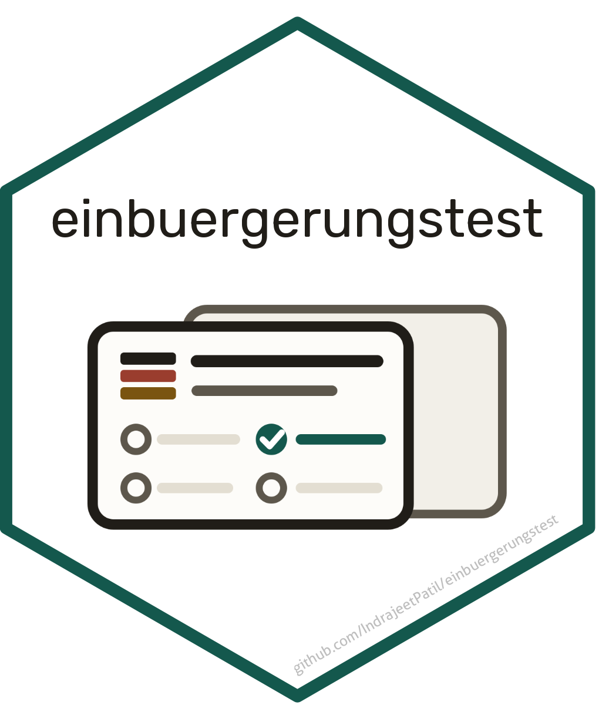
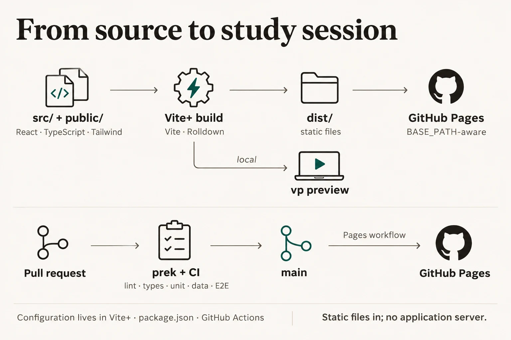

# Leben in Deutschland — Einbürgerungstest trainer 

A free study app for the German citizenship test (_Einbürgerungstest_ /
_Leben in Deutschland_). Every question is shown in German and English side by
side, so the exam language and your own build a direct correspondence. Your
results stay in your browser, so you can watch your score climb towards exam
day.

I built this app to practise for my own Einbürgerungstest, and I'm sharing it
so that anyone preparing for theirs can use it too.

**Use it online:** <https://www.indrapatil.com/einbuergerungstest/>

## What you can do

- **Take a mock exam** — the real format: 33 questions (30 general, 3 about
  your Bundesland), 60 minutes, 17 correct to pass.
- **Practise with explanations** — immediate feedback in both languages, an
  explanation of _why_ the answer is right, and missed questions coming back a
  few questions later.
- **Track your progress** — score chart up to exam day, catalogue coverage,
  weak spots and a daily streak.
- **Look things up** — a searchable read-through of all 310 questions that can
  come up for you.
- **Check current affairs** — the questions whose answer depends on when you
  take the test (Chancellor, head of state, Bundestag, population, EU), with
  the latest facts, their sources and when they were last checked.

## Run it locally

```sh
make install   # once: locked JavaScript and Python dependencies
make start     # builds, serves on http://localhost:5179 and opens the browser
```

Pick your Bundesland and set your exam date on first launch. Run `make` to see
every other command; [CONTRIBUTING.md](CONTRIBUTING.md) covers using it for
your own exam.

## How it works


The questions are built once from the official catalogue, then everything runs
in your browser: the app asks the questions, checks each answer against the
official key and stores it in the browser's IndexedDB. There is no server, so
the same static files run locally and on GitHub Pages. Export a backup from the
dashboard to keep your progress or move it to another browser. The published
site counts visits with Google Analytics, like the rest of
[indrapatil.com](https://www.indrapatil.com/privacy/); your answers and
progress are never sent.



## Tech stack

| Layer      | Tools                                                                   |
| ---------- | ----------------------------------------------------------------------- |
| App        | React 19, Tailwind CSS 4, TypeScript 7, IndexedDB                       |
| Hosting    | GitHub Pages, deployed from `main`                                      |
| Toolchain  | [Vite+](https://viteplus.dev): Vite 8 / Rolldown, Oxlint, Oxfmt, Vitest |
| Data build | Python 3.15 (uv, Ruff, ty, pyrefly, pytest), poppler                    |
| Testing    | Vitest, Playwright with axe accessibility audits                        |

Most of the tooling is written in Rust (Rolldown, Oxc, Tailwind's engine, uv,
Ruff, ty, prek, typos, lychee) for fast feedback. Every lint rule is on, with
narrow exceptions explained in place; the [quality gates](docs/development.md#quality-gates)
run on every pull request.

## Documentation

| Read                                           | For                                                      |
| ---------------------------------------------- | -------------------------------------------------------- |
| [Quiz design](docs/quiz-design.md)             | Exam rules, questionnaire practices, smart mix, mastery  |
| [Architecture](docs/architecture.md)           | Components, request flow, API                            |
| [Illustrations](docs/illustrations.md)         | Generated architecture diagrams and their prompts        |
| [Progress database](docs/progress-database.md) | Stored document, scoring, transactions, backups          |
| [Question data](docs/question-data.md)         | Sources, cross-validation, pictures, new BAMF editions   |
| [Development](docs/development.md)             | Commands, checks, git hooks, CI, versions, agent tooling |
| [DESIGN.md](DESIGN.md)                         | Visual design: tokens, state colours, components         |
| [AGENTS.md](AGENTS.md)                         | Conventions for coding agents                            |

## Licence

The code is released under the [MIT licence](LICENSE). The question data
combines the official BAMF catalogue with MIT-licensed translations and
explanations; see [THIRD-PARTY-NOTICES.md](THIRD-PARTY-NOTICES.md).

Photos the BAMF catalogue credits to third parties are replaced by freely
licensed Wikimedia Commons photos under their own CC BY-SA licences.
