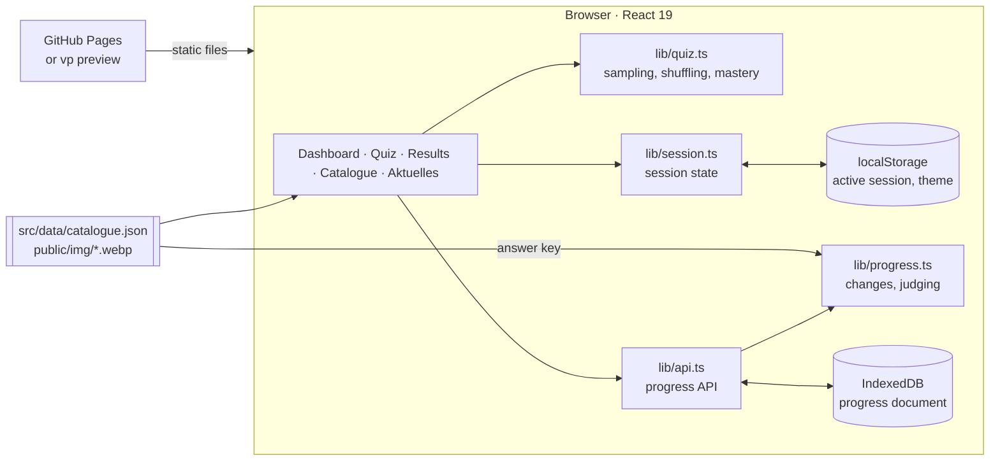

# Architecture

A static React single-page app. Questions come from a JSON file built ahead of
time (see [Question data](question-data.md)); progress is kept in the
browser's IndexedDB. There is no server: the same files run on `localhost` and
on GitHub Pages.

## Components



| Layer | Files | Role |
| --- | --- | --- |
| UI | `src/App.tsx`, `src/components/*` | One component per file: screens, bilingual question rows, feedback, chart |
| Quiz rules | `src/lib/quiz.ts`, `mastery.ts`, `dates.ts` | Exam draw, practice selection, mastery, streaks (pure, unit-tested) |
| Current affairs | `src/lib/currentAffairs.ts` | Time-dependent questions with the latest facts, sources and check date |
| Session state | `src/lib/session.ts` | Option order, answers, flags, retry queue, timing; persisted to `localStorage` |
| Theme | `src/lib/theme.ts`, `useTheme.ts`, `index.html` | Light or dark: the stored choice, else the system setting; applied before first paint |
| Hooks | `src/lib/use*.ts` | Summary, view, trainer, quiz and backup controllers; quiz actions read the latest session |
| Schemas | `src/lib/schemas.ts` | Zod schemas and inferred types for every value that crosses a boundary |
| API | `src/lib/api.ts` | The app's only entry to progress: summary, settings, sessions, answers, backups |
| Store | `src/lib/progress.ts`, `progressViews.ts`, `progressDb.ts`, `backup.ts` | Pure changes and answer judging, statistics, the IndexedDB transaction, backup files — see [Progress database](progress-database.md) |
| Hosting | `vite.config.ts`, `.github/workflows/pages.yml` | `vp preview` locally; GitHub Pages with `BASE_PATH=/<repository>/` |

## Request flow

A practice answer, from key press to saved result:


A mock exam stores nothing per question. On submit (or when the timer runs
out) it passes every answer to `api.finish`, stored in a single transaction.

## API

`src/lib/api.ts` keeps the shape of the former HTTP API, so hooks and
components do not know where progress lives.

| Call | Purpose |
| --- | --- |
| `summary()` | Settings, finished sessions and per-question statistics |
| `updateSettings(patch)` | Bundesland, exam date, English column, option shuffling |
| `startSession(input)` | Start a session; returns its id |
| `answer(id, input)` | Record one practice answer; returns whether it was correct |
| `finish(id, answers, durationMs)` | Close a session; mock exams include all their answers |
| `discard(id)` | Abandon a session (deleted if empty, otherwise closed) |
| `exportBackup()` / `importBackup(file)` / `resetProgress()` | The **Your data** section |

Invalid input (an unknown question or state, an option outside 0–3, a
finished session) throws a `ValidationError` and changes nothing; the app
shows it in the error banner.

## Design decisions

| Decision | Reason |
| --- | --- |
| No server; progress in IndexedDB | The app can be hosted as static files, and progress never leaves the browser |
| Google Analytics in `index.html`, skipped on `localhost` and `127.0.0.1` | Visits are counted like on every page of the indrapatil.com website; local runs and tests send nothing |
| One document, changed by pure functions | Validation, judging and statistics are unit-tested without a browser; each change is one transaction |
| Answers judged in the store, against the bundled key | Stored results and imported backups never depend on what the caller claims |
| Active session in `localStorage`, results in IndexedDB | Reloads resume instantly; only finished evidence is permanent |
| Hash routes (`#katalog`, `#aktuell`) | Work on GitHub Pages' subpath without a 404 fallback |
| Base path from `BASE_PATH` | `/` locally, `/<repository>/` on Pages; pictures use `import.meta.env.BASE_URL` |
| Catalogue bundled as its own chunk | App code and question data cache independently |
| Hand-drawn SVG chart | One small chart does not justify a charting library |

## Files

```text
src/       React app
  lib/     quiz logic, session state, progress store, shared types
  data/    generated question catalogue
public/    favicon and generated question pictures
scripts/   data pipeline (uv project with pytest suite)
tests/e2e/ Playwright end-to-end and accessibility tests
makefiles/ Make targets by topic
docs/      this documentation
```
