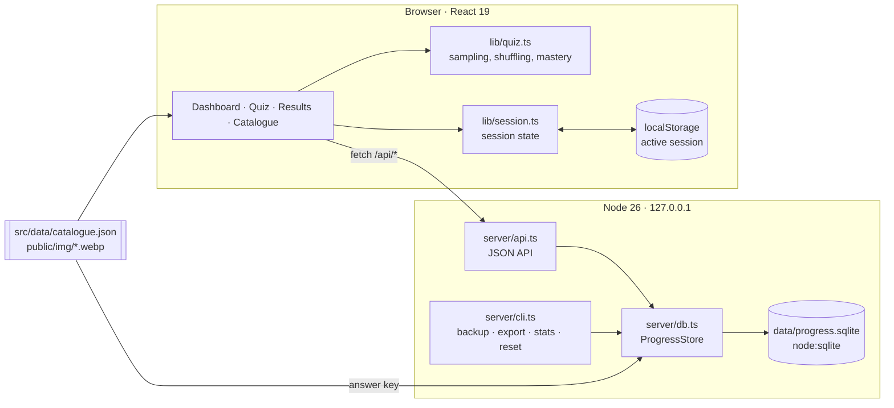
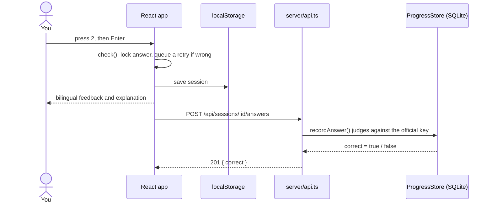

# Architecture

A React single-page app talks to a small Node server on `localhost`, which
stores progress in a SQLite file. The question catalogue is a static JSON file
built ahead of time (see [Question data](question-data.md)).

## Components



| Layer         | Files                               | Role                                                                                           |
| ------------- | ----------------------------------- | ---------------------------------------------------------------------------------------------- |
| UI            | `src/App.tsx`, `src/components/*`   | Views, bilingual question rows, feedback, score chart                                          |
| Quiz logic    | `src/lib/quiz.ts`                   | Exam draw, practice selection, mastery, streaks (pure functions)                               |
| Session state | `src/lib/session.ts`                | Option order, answers, flags, retry queue, timing; persisted to `localStorage`                 |
| API client    | `src/lib/api.ts`                    | Typed `fetch` wrapper                                                                          |
| Shared types  | `src/lib/types.ts`                  | Used by both browser and server                                                                |
| API           | `server/api.ts`                     | Connect-style handler with input validation                                                    |
| Store         | `server/db.ts`                      | Migrations, answer judging, statistics, backup — see [Progress database](progress-database.md) |
| Servers       | `vite.config.ts`, `server/serve.ts` | The same API mounted in `vp dev`, `vp preview` and the production server                       |
| CLI           | `server/cli.ts`                     | `make backup`, `export`, `stats`, `reset-progress`                                             |

## Request flow

A practice answer, from key press to saved result:



A mock exam sends nothing per question. On submit (or when the timer runs out)
it posts every answer in one `finish` request, stored in a single transaction.

## API

| Method   | Path                        | Purpose                                                 |
| -------- | --------------------------- | ------------------------------------------------------- |
| `GET`    | `/api/summary`              | Settings, finished sessions and per-question statistics |
| `PUT`    | `/api/settings`             | Bundesland, exam date, English column, option shuffling |
| `POST`   | `/api/sessions`             | Start a session; returns its id                         |
| `POST`   | `/api/sessions/:id/answers` | Record one practice answer                              |
| `POST`   | `/api/sessions/:id/finish`  | Close a session; mock exams include all their answers   |
| `DELETE` | `/api/sessions/:id`         | Abandon a session (deleted if empty, otherwise closed)  |
| `GET`    | `/api/export`               | Full JSON dump                                          |

| Status | When                                                                                |
| ------ | ----------------------------------------------------------------------------------- |
| `400`  | Validation failed (unknown question or state, option outside 0–3, finished session) |
| `415`  | A write without `Content-Type: application/json`                                    |
| `404`  | Unknown route                                                                       |

## Design decisions

| Decision                                            | Reason                                                        |
| --------------------------------------------------- | ------------------------------------------------------------- |
| The server judges correctness                       | The stored result never depends on what the browser claims    |
| One API handler for every server                    | Dev, preview and production cannot drift apart                |
| Active session in `localStorage`, results in SQLite | Reloads resume instantly; only finished evidence is permanent |
| Server binds `127.0.0.1` only                       | Single-user local app; nothing is exposed to the network      |
| JSON-only writes, 256 KB body cap                   | Blocks cross-site form posts and oversized requests           |
| Catalogue bundled as its own chunk                  | App code and question data cache independently                |
| Node 26 runs `server/*.ts` directly                 | No build step for the server; erasable TypeScript syntax only |
| Hand-drawn SVG chart                                | One small chart does not justify a charting library           |

## Files

```text
server/    API, SQLite store, static server, maintenance CLI
src/       React app
  lib/     quiz logic, session state, API client, shared types
  data/    generated question catalogue
public/    favicon and generated question pictures
scripts/   data pipeline (Python uv script)
docs/      this documentation
data/      your progress database, backups and exports (git-ignored)
```
