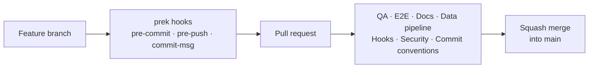

# Development

## Prerequisites

| Tool | Why |
| --- | --- |
| Node 26 and [Vite+](https://viteplus.dev) (`vp`) | Runtime and toolchain; `vp` provisions pnpm |
| [uv](https://docs.astral.sh/uv/) | Python data pipeline and its tools (Ruff, ty, pyrefly, pytest) |
| poppler (`pdftotext`, `pdftoppm`) | Only for `make data` |
| [prek](https://github.com/j178/prek) | Git hooks (run through `uv tool run`) |
| typos, lychee, gitleaks | Spelling, links and secret scanning |
| Docker | Pinned actionlint, gitleaks and Playwright images |

Run `make install` once, then `make hooks-install`.

## Make targets

Run `make` for the full list with descriptions.

| Group | Targets |
| --- | --- |
| App | `start`, `serve`, `open`, `dev`, `build`, `stats`, `backup`, `export`, `reset-progress CONFIRM=yes` |
| Quality | `qa`, `qa-js`, `qa-python`, `lint`, `typecheck`, `fallow`, `css-quality`, `file-naming`, `lint-markdown`, `spell-check`, `link-check`, `format`, `fix`, `ci` |
| Tests | `test`, `test-unit`, `test-watch`, `test-scripts`, `test-e2e`, `test-e2e-docker` |
| Security | `security`, `secret-scan`, `workflow-lint`, `workflow-audit`, `audit-js`, `audit-python` |
| Hooks | `hooks-install`, `hooks`, `hooks-push`, `hooks-update` |
| Data | `data`, `data-refresh` |
| Maintenance | `install`, `outdated`, `update`, `doctor`, `clean`, `distclean` |

| Port | Server |
| --- | --- |
| 5178 | `make dev` (hot reload) |
| 5179 | `make start` / `make serve` (production build) |
| 5199 | End-to-end tests and screenshots (throwaway database) |

## Quality gates

The bar matches [indrajeetpatil.github.io](https://github.com/IndrajeetPatil/indrajeetpatil.github.io): every rule on,
with narrow exceptions explained next to their configuration.

| Gate | Tool and policy | Make target |
| --- | --- | --- |
| File naming | ls-lint: kebab-case, PascalCase components, camelCase modules, snake_case Python | `file-naming` |
| Formatting | Oxfmt (80 columns, sorted imports); Ruff format | `lint`, `lint-python` |
| TypeScript lint | Oxlint, type-aware, **every category as errors**, 12 plugins, complexity ≤ 5, warnings fail | `lint` |
| Types | TypeScript 7 with the strictest options (`exactOptionalPropertyTypes`, `noUncheckedIndexedAccess`, …) | `typecheck` |
| Boundaries | Zod schemas validate the catalogue, API bodies, SQLite rows and `localStorage` | — |
| Unit tests | Vitest, shuffled order, coverage floors that only rise | `test-unit` |
| Dead code and health | fallow: unused files, exports and dependencies, duplication, cyclomatic and cognitive ≤ 5, CRAP ≤ 21 | `fallow` |
| CSS | Project Wallace: maintainability ≥ 98, complexity 100 | `css-quality` |
| Python lint | Ruff `ALL` with preview, mccabe ≤ 5, lazy imports required | `lint-python` |
| Python types | ty with every rule; pyrefly 100% type coverage | `typecheck-python`, `typecoverage-python` |
| Python tests | pytest strict mode, warnings as errors | `test-scripts` |
| End to end | Playwright on desktop and mobile, axe WCAG 2.2 AA audit of every screen | `test-e2e` |
| Markdown | rumdl | `lint-markdown` |
| Spelling | typos, British English | `spell-check` |
| Links | lychee | `link-check` |
| Secrets | gitleaks over the whole history | `secret-scan` |
| Workflows | actionlint (syntax and shell), zizmor (security) | `workflow-lint`, `workflow-audit` |
| Dependencies | pnpm audit, uv audit | `audit-js`, `audit-python` |

`make ci` runs everything the pull-request workflows run except end-to-end
tests and security, which have their own targets.

## Git workflow

| Hook stage | Runs |
| --- | --- |
| pre-commit | Ruff, rumdl, typos, ls-lint, Oxfmt + Oxlint, file hygiene |
| pre-push | TypeScript and Python types, unit tests |
| commit-msg | Conventional Commits (strict) |

| Rule | Detail |
| --- | --- |
| Commit messages and PR titles | Conventional Commits (`feat`, `fix`, `docs`, `refactor`, `test`, `build`, `ci`, `chore`, …) |
| `main` | `protected-main` ruleset: pull requests, squash merges only, every workflow's check required, no deletion or force-push |
| Workflows | Pull requests only; actions pinned to full commit SHAs; read-only token; no persisted credentials |
| Merge settings | Squash only, auto-merge allowed, branches deleted after merge |

## Versions

Each version has one source of truth.

| Tool | Declared in |
| --- | --- |
| Node | `.node-version` (and a compatible `engines` in `package.json`) |
| pnpm | `devEngines.packageManager` in `package.json` |
| Vite+ | `catalog` in `pnpm-workspace.yaml`, plus `VP_VERSION` and checksums in `scripts/install-vp.sh` |
| Python and its tools | `scripts/pyproject.toml`, locked in `scripts/uv.lock` |
| Playwright image | `.github/workflows/e2e.yml` and `makefiles/testing.mk`, matching `@playwright/test` |
| prek | `PREK_VERSION` in `makefiles/hooks.mk`, `minimum_prek_version` in `prek.toml`, `prek-version` in the workflows |
| rumdl, zizmor, actionlint, gitleaks | `makefiles/quality.mk`, `makefiles/security.mk` |
| GitHub Actions | Commit SHA plus `# vX.Y.Z` comment in each workflow |

The [`update-deps` prompt](../.github/prompts/update-deps.md) walks through
upgrading all of them.

## Agent tooling

| Kind | Files |
| --- | --- |
| Conventions | [AGENTS.md](../AGENTS.md), imported by `CLAUDE.md` |
| Skills | [`agent-browser`](../.agents/skills/agent-browser/SKILL.md), [`frontend-pr-screenshot`](../.agents/skills/frontend-pr-screenshot/SKILL.md) |
| Prompts | [`address-review`](../.github/prompts/address-review.md), [`update-deps`](../.github/prompts/update-deps.md), [`simplify-codebase`](../.github/prompts/simplify-codebase.md), [`codex-security`](../.github/prompts/codex-security.md) |

## Design

The interface follows [DESIGN.md](../DESIGN.md), which extends the
[indrapatil.com DESIGN.md](https://github.com/IndrajeetPatil/indrajeetpatil.github.io/blob/main/DESIGN.md):
warm paper background, Fraunces headings, Hanken Grotesk text, one teal accent
for interaction, flat surfaces without shadows, in light and dark modes.
