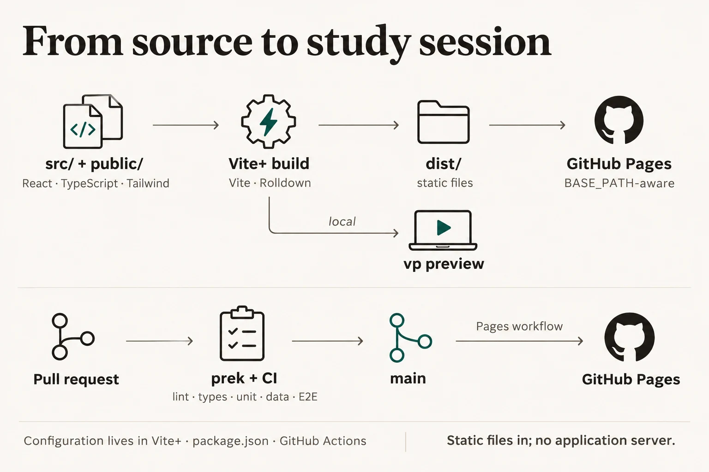

# Documentation illustrations

These diagrams are generated explanatory artwork. The README covers the app
architecture and deployment path; [Architecture](architecture.md) shows what
happens when a learner answers a practice question. Keep the searchable
explanations alongside the images, and update these prompts whenever an image
is regenerated. The palette and typography follow [DESIGN.md](../DESIGN.md).

## App architecture


```text
Create a landscape 3:2 explanatory documentation infographic for the Einbürgerungstest bilingual study app. Use the supplied images only as style references. Match the project's DESIGN.md: warm paper #faf8f4, ink #201d18, muted ink #5d574c, fine hairlines #e3ded2, restrained teal #14584d; Fraunces-like serif title and Hanken Grotesk-like labels. Flat editorial diagram, generous whitespace, fine consistent strokes, simple monochrome line icons, no shadows, gradients, 3D, decorative cards, large logos, invented values, or tiny text. Exact title: “How the study app works”. Compose as a readable left-to-right flow with clear container grouping. Left: “Question catalogue” with “310 general + 10 state questions” and source note “BAMF catalogue · built before release”. Centre: large browser boundary labelled “Your browser · static React app”. Inside place three connected areas: “Screens” with “dashboard · exam · practice · catalogue”; “Quiz logic” with “draw · shuffle · score”; “Progress API” with “validate · judge · save”. Make the direction clear: catalogue → screens and quiz logic; screens → progress API. Right within the browser: “IndexedDB” labelled “saved progress” and “localStorage” labelled “active session · preferences”; progress API points only to IndexedDB, session state points to localStorage. Outside the browser at far right or top, small “GitHub Pages / local preview” node delivering static files to the browser. Include a compact note exactly “Answers and progress stay in this browser.” Do not imply a backend server or any progress upload. Keep every label exact, correctly spelled, large and readable; balanced composition, no clipped text.
```

## Build and deployment



```text
Create a landscape 3:2 documentation infographic for the Einbürgerungstest app showing how source, configuration, CI and deployment fit together. Use the supplied reference images only for style: warm paper #faf8f4, dark warm ink #201d18, muted ink #5d574c, hairline #e3ded2, restrained teal #14584d; serif title like Fraunces, clear Hanken-like sans labels; flat editorial diagram with precise arrows and generous whitespace. No shadows, gradients, 3D, decorative cards, fake metrics, tiny copy, or illegible text. Exact title: “From source to study session”. Top row, left to right: “src/ + public/” with small “React · TypeScript · Tailwind”; arrow to “Vite+ build” with small “Vite · Rolldown”; arrow to “dist/” with small “static files”. From dist, arrow to “GitHub Pages” with small “BASE_PATH-aware”; also show an alternate local route from Vite+ build to “vp preview” labelled “local”. Beneath this path show pull-request checks: “Pull request” → “prek + CI” → “lint · types · unit · data · E2E”; a thin arrow from passing checks to “main”, then “Pages workflow” to “GitHub Pages”. Ensure PR checks are not presented as deployment: only main deploys. Add a small configuration note in a quiet bottom area: “Configuration lives in Vite+ · package.json · GitHub Actions”. Exact footer: “Static files in; no application server.” Clear spacing, correct direction, all specified labels legible and spelled exactly.
```

## Answer and progress flow


```text
Create a landscape 3:2 documentation infographic for the Einbürgerungstest app's practice-answer data flow. Match the supplied style references and project DESIGN.md: warm paper #faf8f4, dark warm ink #201d18, muted ink #5d574c, hairline #e3ded2, restrained teal #14584d. Fraunces-like serif title, Hanken-like sans labels, precise thin arrows, simple line icons, ample whitespace, editorial technical diagram. No shadows, gradients, 3D, decorative cards, fake values, or small unreadable text. Exact title: “From answer to saved progress”. Show one left-to-right sequence of six stages, with a clear browser boundary around the five browser-owned stages after the learner: 1 “Learner” with “chooses an answer”; 2 “React screen” with “locks choice · shows feedback”; 3 “Session” with “retry queue · timing” and a small side arrow down to “localStorage · active session”; 4 “Local API” with “validates answer”; 5 “Progress store” with “checks official answer key”; 6 “IndexedDB” with “one readwrite transaction”. Connect stages left to right using arrows. Add an arrow from the progress store to IndexedDB labelled “commit result”; add a return arrow from the API toward the React screen labelled “correct / incorrect”. Keep text and arrows from overlapping. Add a small side note exactly “Mock exam answers are saved together when submitted.” Footer exactly “The server never receives answers or progress.” Do not show network calls, remote storage, or a server. Ensure every label is exact, correctly spelled, clearly legible and accurately connected.
```
