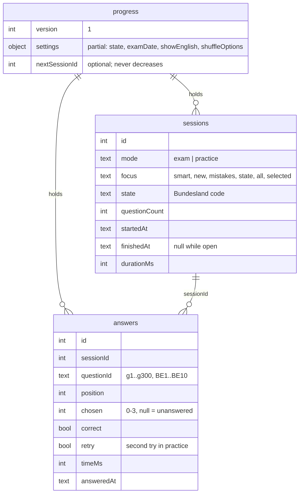

# Progress database

Your progress lives in this browser's IndexedDB: database `einbuergerungstest`,
object store `progress`, one document under the key `progress`. Progress is
never sent anywhere. Each browser (and each device) keeps its own progress; export a
backup to keep it safe or move it.

## Document

The document is validated with `progressSchema` (`src/lib/schemas.ts`) every
time it is read, and timestamps are ISO 8601 in UTC. Ids are one more than the
highest in use, as SQLite's `INTEGER PRIMARY KEY` would choose them, except
session ids, which come from `nextSessionId` and are never reused: after a reset
or import, a session still open in another tab fails with "unknown session"
instead of writing into a newer session with the same id. Documents written
before the counter existed count from their highest session id.

## How changes are applied

| Layer | File | Role |
| --- | --- | --- |
| Changes | `src/lib/progress.ts` | Pure functions from one document to the next; validation and answer judging |
| Views | `src/lib/progressViews.ts` | Settings with defaults, session scores, per-question statistics |
| Storage | `src/lib/progressDb.ts` | Reads the document, applies a change and writes it in one `readwrite` transaction |
| API | `src/lib/api.ts` | The calls the app makes: summary, settings, sessions, answers, backups |

Because each change runs inside one transaction, two open tabs cannot overwrite
each other's answers, and a change that throws (an unknown question, a
finished session, a malformed value) aborts the transaction and writes nothing.
The app asks the browser to keep the data persistent
(`navigator.storage.persist()`), so it is not evicted under storage pressure.

## How results are derived

| Figure              | Rule                                                                                                      |
| ------------------- | --------------------------------------------------------------------------------------------------------- |
| Correct             | Judged in `progress.ts` against the official answer key, never taken from the caller or a backup file      |
| Session score       | First tries only (`retry = false`); unanswered exam questions count as wrong                              |
| Session accuracy    | Mock exam: correct / 33. Practice: correct / answered                                                     |
| Question statistics | All answers, including second tries: attempts, correct, last answered, and the last five results newest first |
| Mastery             | Derived in the app from the last five results — see [Quiz design](quiz-design.md#mastery)                 |

## Lifecycle

| Event              | Effect                                                         |
| ------------------ | -------------------------------------------------------------- |
| Start              | Session with `finishedAt = null`                               |
| Practice answer    | Answer stored immediately                                      |
| Mock exam submit   | All answers and `finishedAt` stored in one transaction         |
| End practice early | Session closed; answers so far count                           |
| Discard            | Deleted if it has no answers, otherwise closed with its elapsed time |

Only finished sessions appear on the dashboard.

## Backups

The dashboard's **Ihre Daten · Your data** section exports, imports and resets
progress.

| Action | Does |
| --- | --- |
| Export backup | Downloads `einbuergerungstest-YYYY-MM-DD.json`: `{ app, exportedAt, progress }` |
| Import backup | Validates the file, checks every answer has its session, judges every answer again, closes its open sessions, then replaces all progress |
| Reset progress | Deletes every session and answer after a confirmation; settings stay |

Answers name their question by `questionId`: `g1` to `g300` for the general
questions and the state code plus number (`BE1` to `BE10`) for state
questions. The catalogue shows each question's ID, and searching it for an
exact ID finds that question alone, so a backup can be traced back to the
questions it records.

Import and reset are disabled while a session is in progress. Clearing the
browser's site data deletes the progress, so export a backup now and then.

## Schema changes

`progress.version` and the IndexedDB version (`DB_VERSION` in
`progressDb.ts`) are the places for future migrations: bump the version,
convert old documents in the `upgradeneeded` handler or when decoding, and
keep reading backups of every earlier version. Never change the meaning of
an existing field in place.

## Tests

Unit tests run the pure changes and views (`progress.test.ts`,
`backup.test.ts`) without a browser. The end-to-end suite covers the
IndexedDB layer: every test starts with an empty database of its own, and one
test exports, resets and imports a backup.
