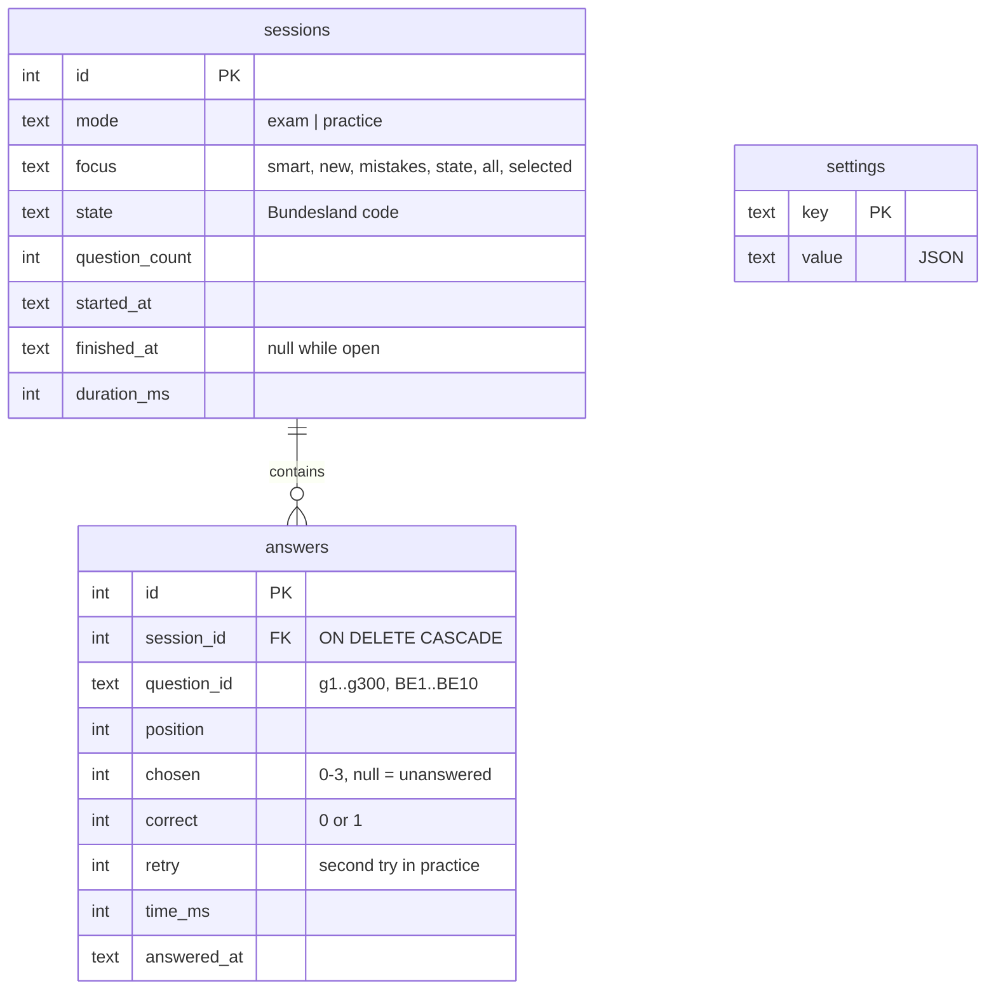

# Progress database

Every answer is stored in `data/progress.sqlite`, a single SQLite file opened
through Node's built-in `node:sqlite`. The file is git-ignored: it is your
personal progress.

## Schema

| Table      | Holds                                                                    |
| ---------- | ------------------------------------------------------------------------ |
| `sessions` | One row per mock exam or practice session                                |
| `answers`  | One row per answer, including second tries and unanswered exam questions |
| `settings` | Bundesland, exam date, English column, option shuffling                  |

`CHECK` constraints guard `mode`, `chosen`, `correct` and `retry`; foreign keys
are enforced, and timestamps are ISO 8601 in UTC.

## How results are derived

| Figure              | Rule                                                                                                                                                        |
| ------------------- | ----------------------------------------------------------------------------------------------------------------------------------------------------------- |
| Correct             | Decided by the server from the official answer key, never by the browser                                                                                    |
| Session score       | First tries only (`retry = 0`); unanswered exam questions count as wrong                                                                                    |
| Session accuracy    | Mock exam: correct / 33. Practice: correct / answered                                                                                                       |
| Question statistics | All answers, including second tries: attempts, correct, last answered, and the last five results newest first (window function plus ordered `GROUP_CONCAT`) |
| Mastery             | Derived in the app from the last five results — see [Quiz design](quiz-design.md#mastery)                                                                   |

## Lifecycle

| Event              | Effect                                                               |
| ------------------ | -------------------------------------------------------------------- |
| Start              | `sessions` row with `finished_at = null`                             |
| Practice answer    | `answers` row written immediately                                    |
| Mock exam submit   | All answers and `finished_at` written in one transaction             |
| End practice early | Session closed; answers so far count                                 |
| Discard            | Deleted if it has no answers, otherwise closed with its elapsed time |

Only finished sessions appear on the dashboard.

## Migrations

`MIGRATIONS` in `server/migrations.ts` is an ordered list of SQL scripts.
`PRAGMA user_version` records how many have run; each new one runs in a
transaction when the store opens. Never edit an applied migration — append a
new one.

## Backups and maintenance

| Command                           | Does                                                   |
| --------------------------------- | ------------------------------------------------------ |
| `make backup`                     | Consistent snapshot (`VACUUM INTO`) in `data/backups/` |
| `make export`                     | Everything as JSON in `data/exports/`                  |
| `make stats`                      | Recent mock-exam scores in the terminal                |
| `make reset-progress CONFIRM=yes` | Backs up, then deletes all progress                    |

`backup`, `export` and `stats` work while the app is running: the database uses
WAL mode with a busy timeout, so a second process can read and write safely.
Stop the app before `reset-progress`, which deletes the file.

Set `LID_DB=/path/file.sqlite` to use another file. Tests use `:memory:`, and
screenshots and manual checks use a throwaway file, so your real progress is
never touched.

## Why `node:sqlite` and not Turso

> [!NOTE]
> [Turso](https://github.com/tursodatabase/turso), the Rust rewrite of SQLite,
> was evaluated on 31 October 2026 (`@tursodatabase/database` 0.8.3) by running
> this store's own code against it. Most of it worked, but not all of it:
>
> - `GROUP_CONCAT(... ORDER BY ...)`, which builds each question's recent
>   results, fails with _"ORDER BY clause is not supported yet in aggregate
>   functions"_.
> - `VACUUM INTO ?`, used by `make backup`, rejects a bound path; it needs the
>   path spliced into the SQL text.
> - By default Turso locks the file to one process, so `make backup`,
>   `export` and `stats` fail while the app is running. Only the experimental
>   `multiprocess_wal` option avoids that.
> - Turso is pre-1.0, and its own FAQ advises keeping independent backups.
> - It adds a native npm package with per-platform binaries, where
>   `node:sqlite` is built into Node.
>
> Its strengths (concurrent writers, async I/O, vector search, change feeds,
> cloud sync, encryption) don't help a single-user app writing a few hundred
> rows a day, so switching would only add compromises.
>
> Switching later is cheap: Turso reads and writes ordinary SQLite files, so it
> would be a driver change rather than a data migration. Reconsider at Turso
> 1.0, once ordered aggregates and multi-process access are stable — or if
> progress should sync across devices.
