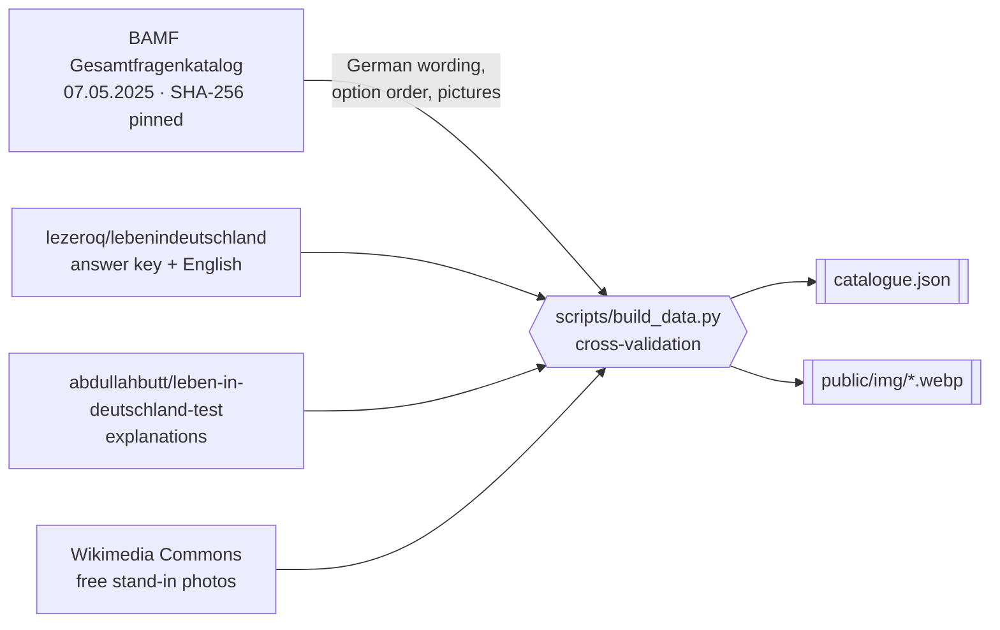

# Question data

`src/data/catalogue.json` (460 questions) and `public/img/*.webp` (42
pictures) are generated by `make data`. Never edit the generated files by hand.

| Module | Role |
| --- | --- |
| `scripts/sources.py` | Pinned sources: download, SHA-256 check, typed readers |
| `scripts/pdf_text.py` | Questions and options from the PDF's text layer |
| `scripts/pdf_layout.py` | Picture regions from the PDF's bounding-box layout |
| `scripts/pictures.py` | Renders, trims and saves pictures as WebP |
| `scripts/photos.py` | Freely licensed stand-ins for third-party press photos |
| `scripts/text_match.py` | Normalising and matching wordings across sources |
| `scripts/build_data.py` | Cross-validation and the output files |

`scripts/` is a uv project (`pyproject.toml`, `uv.lock`) held to Ruff `ALL`,
ty with every rule, 100% pyrefly type coverage and a pytest suite.

## Pipeline

| Source                                                                                                                                      | Licence              | Used for                                                           |
| ------------------------------------------------------------------------------------------------------------------------------------------- | -------------------- | ------------------------------------------------------------------ |
| [BAMF Gesamtfragenkatalog](https://www.bamf.de/SharedDocs/Anlagen/DE/Integration/Einbuergerung/gesamtfragenkatalog-lebenindeutschland.html) | Official publication | German text, option order, pictures                                |
| [lezeroq/lebenindeutschland](https://github.com/lezeroq/lebenindeutschland)                                                                 | MIT                  | Answer key (from the BAMF Online-Testcenter), English translations |
| [abdullahbutt/leben-in-deutschland-test](https://github.com/abdullahbutt/leben-in-deutschland-test)                                         | MIT                  | Explanations                                                       |
| [Wikimedia Commons](https://commons.wikimedia.org/)                                                                                         | CC BY-SA             | Photos in place of the PDF's third-party press photos             |

All are pinned (PDF and photos by SHA-256, repositories by commit) and cached
in `.cache/sources/`.

## Catalogue structure

| Part                        | Questions | Ids                                        |
| --------------------------- | --------- | ------------------------------------------ |
| General                     | 300       | `g1`–`g300`                                |
| Each of the 16 Bundesländer | 10        | `BW1`–`BW10`, `BY1`–`BY10`, … `TH1`–`TH10` |

Each entry holds the German and English question and options, the index of the
correct option, an optional picture and credit, an English explanation (plus a
German one where the source has a substantive one), and `keepOrder` for
options that must not be shuffled.

## Cross-validation

The build fails, listing every problem, when:

| Check                                           | Catches                                               |
| ----------------------------------------------- | ----------------------------------------------------- |
| PDF checksum differs                            | A new BAMF edition                                    |
| Answer-key wording differs from the PDF         | A key built for another edition, or reordered options |
| An explanation names a different correct answer | Explanations written for older wording                |
| Picture detection disagrees with the answer key | Pictures missing or misplaced                         |
| A "©" photo has no entry in `scripts/photos.py`  | Third-party photos reaching the published site        |
| Not exactly 460 questions                       | Parsing errors                                        |

Two documented exceptions in the script: `HB4` gets a hand-written
explanation (the source explained an older question), and `BB1` keeps its
explanation although the source used an older picture layout, because it
describes the coat of arms rather than its position.

## Pictures

Picture regions are found in the PDF's text layout (a large gap between the
question and its first option), rendered with `pdftoppm`, trimmed and saved as
WebP with Pillow.

The PDF credits five photos to the Bundesregierung or the Deutscher Bundestag
("©"). The site is public, so `scripts/photos.py` replaces each with a pinned,
freely licensed Wikimedia Commons photo of the same subject, optionally
cropped, or lists it in `WITHOUT_PICTURE` when no free photo exists (`g70`,
whose text alone answers it). The credit under the picture names the
replacement; full attribution is in
[THIRD-PARTY-NOTICES.md](../THIRD-PARTY-NOTICES.md#photos). A new edition with
another "©" photo stops the build until it is handled the same way.

## Time-dependent answers

A few general questions ask about the present: the Chancellor (`g72`), the two
largest parliamentary groups (`g73`), the head of state (`g75`), the
population (`g213`) and the number of EU member states (`g236`). Their answers
can change between BAMF editions, so the **Aktuelles** page (`#aktuell`) shows
each official answer beside the latest facts, their sources and the day they
were last checked. The facts live in `src/lib/currentAffairs.ts`, not in the
generated catalogue.

To re-check them:

1. Verify each fact against its sources, preferring official ones
   (Bundesregierung, Bundestag, Destatis, the EU).
2. Update `latest`, `outlook` and `sources`, and set `option` to the catalogue
   option that is correct today. When it differs from the answer key, the page
   marks the official answer as out of date.
3. Move `CHECKED` to the day of the check and run `make ci`.

Answers are still judged against the official key, as the exam does.

## When BAMF publishes a new edition

1. `make data-refresh` downloads the sources again and stops on the checksum.
2. Review the new edition and wait for the answer-key source to cover it.
3. Update `EDITION`, `PDF_SHA256` and the pinned commits in
   `scripts/sources.py`, then run `make data`.
4. Resolve any cross-validation failures, then run `make ci`.
