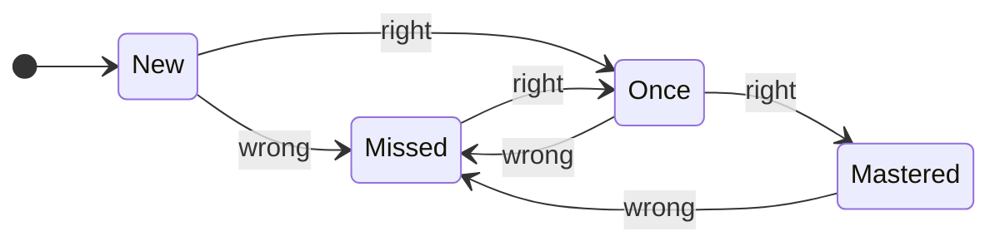

# Quiz design

How questions are chosen, presented and scored, and which questionnaire
practices the app follows. The rules live in `src/lib/quiz.ts` (selection),
`src/lib/mastery.ts` (mastery) and `src/lib/session.ts` (session state), all
covered by unit tests.

## Modes

| Mode                               | Questions                                                                                               | Feedback                                | Scoring                                                  |
| ---------------------------------- | ------------------------------------------------------------------------------------------------------- | --------------------------------------- | -------------------------------------------------------- |
| **Prüfungssimulation** (mock exam) | 30 random general questions, then 3 random Bundesland questions (positions 31–33, as on the real paper) | None until you submit                   | Correct out of 33; 17 passes; unanswered counts as wrong |
| **Üben** (practice)                | 10, 20, 33 or 50 from the chosen focus; all of them for _Bundesland_ and _Whole catalogue_              | After every answer                      | First-try accuracy                                       |
| **Fragenkatalog**                  | All 310 questions that can come up for you, searchable in German, English or by question ID             | Answer and explanation on demand        | Not scored                                               |
| **Aktuelles** (current affairs)    | The general questions whose answer depends on when the test is taken                                    | Official answer beside the latest facts | Not scored                                               |

The real test: 33 questions, 60 minutes, at least 17 correct, drawn from 300
general questions plus the 10 for the Bundesland of your main residence. These
numbers live in one constant, `EXAM`. The catalogue words a few questions
identically with different options (for example, twice _Für wie viele Jahre
wird der Bundestag in Deutschland gewählt?_); a mock exam asks each wording at
most once.

## Questionnaire practices

| Practice              | How it is applied                                                                                                                           |
| --------------------- | ------------------------------------------------------------------------------------------------------------------------------------------- |
| No order effects      | Questions are drawn and ordered at random every session (Fisher–Yates shuffle)                                                              |
| No position memory    | Answer options are shuffled per question and session; picture labels (`Bild 1`–`4`) and numbers keep their order because it carries meaning |
| No accidental answers | Nothing is preselected; practice answers need an explicit _Prüfen · Check_                                                                  |
| Exam realism          | Answers stay editable until you submit; questions can be flagged; the submit dialog lists unanswered and flagged questions                  |
| Honest timing         | The exam timer is a wall-clock deadline, so reloading does not reset it; at zero the exam is submitted                                      |
| Robust sessions       | The active session is saved in the browser, so a reload or pause resumes where you left off                                                 |
| Accessible            | Native radio groups, visible focus, keyboard shortcuts, screen-reader labels for correct and wrong answers                                  |

## Feedback on a wrong answer

- The correct option in German **and** English.
- Your answer, struck through, in both languages.
- _Warum · Why_: an explanation of why the answer is right.
- Your record on that question before this session (for example `2/3 correct`
  with ticks and crosses).
- In practice, the question is queued again after four other questions with
  freshly shuffled options. A second miss is not queued again, and second tries
  do not count towards the session score.

## Mastery

Each question's state comes from your most recent answers to it.

| State    | Rule                                  | Dashboard label                   |
| -------- | ------------------------------------- | --------------------------------- |
| New      | Never answered                        | Noch nicht gesehen · Not seen yet |
| Missed   | Last answer wrong                     | Zuletzt falsch · Missed last time |
| Once     | Last answer right, the one before not | Einmal richtig · Correct once     |
| Mastered | Last two answers right                | Sicher · Mastered                 |

## Practice focus

| Focus               | Picks                                                                                                                              |
| ------------------- | ---------------------------------------------------------------------------------------------------------------------------------- |
| Smart mix (default) | Up to half the session from _Missed_ and _Once_ questions, the rest from _New_ and _Mastered_, weighted by priority, then shuffled |
| Not seen yet        | Only _New_ questions                                                                                                               |
| My mistakes         | Only _Missed_ and _Once_ questions                                                                                                 |
| Bundesland          | The 10 questions about your state                                                                                                  |
| Whole catalogue     | All 310 questions in random order                                                                                                  |
| Selected            | A given list, for example _Practise these again_ after a mock exam or the dashboard's weak spots                                   |

Priorities for the smart mix's weighted draw (Efraimidis–Spirakis sampling
without replacement):

| State    | Priority                                                                   |
| -------- | -------------------------------------------------------------------------- |
| Missed   | 6                                                                          |
| New      | 3                                                                          |
| Once     | 2, rising to 3 over three days since the last answer                       |
| Mastered | 0.25, rising to 1.75 over six days, so mastered questions resurface slowly |

## Dashboard figures

| Figure             | Definition                                                                                                              |
| ------------------ | ----------------------------------------------------------------------------------------------------------------------- |
| Latest mock exam   | Correct answers in the most recent mock exam, with pass or fail                                                         |
| Average, last 3    | Mean correct answers over the last three mock exams                                                                     |
| Best               | Highest mock-exam score                                                                                                 |
| Mock exams passed  | Passed / taken                                                                                                          |
| Day streak         | Consecutive days with a finished session, ending today or yesterday                                                     |
| Score chart        | Mock-exam scores as a line and practice first-try accuracy as dots, on one percent axis with the pass mark and exam day |
| Catalogue coverage | Your 310 questions split by mastery state                                                                               |
| Weak spots         | Up to eight questions you have missed: those missed last time first, then by number of misses, then most recent         |

## Keyboard

| Key                | Action                                        |
| ------------------ | --------------------------------------------- |
| `1`–`4` or `A`–`D` | Choose an option                              |
| `Enter`            | Check, then next (practice); next (mock exam) |
| `←` `→`            | Previous / next question (mock exam)          |
| `F`                | Flag the question (mock exam)                 |
| `E`                | Show or hide the English column               |

Hiding English in the last days before the exam checks that you can read the
German alone. The results review still shows the correct and the chosen answer
of every mistake in English, since that is where the translation helps most.
